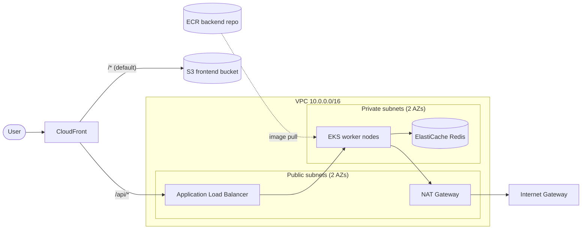

# StartTech Infrastructure

Terraform code and a GitHub Actions pipeline that provision the AWS infrastructure for the StartTech application: a React frontend served through CloudFront and a containerised backend API running on Amazon EKS, with Redis for caching.

---

## Table of Contents

- [Architecture](#architecture)
- [Repository Structure](#repository-structure)
- [Prerequisites](#prerequisites)
- [Configuration](#configuration)
- [Deploying Locally](#deploying-locally)
- [CI/CD Pipeline](#cicd-pipeline)
- [Branch Protection](#branch-protection)
- [Accessing the Resources](#accessing-the-resources)
- [Outputs](#outputs)
- [Cleanup](#cleanup)
- [Troubleshooting](#troubleshooting)

---

## Architecture



| Module | What it creates |
|---|---|
| **networking** | VPC, 2 public and 2 private subnets across two Availability Zones, Internet Gateway, one NAT Gateway (with Elastic IP), and public/private route tables. Subnets are tagged so the load balancer controller can find them. |
| **eks** | EKS cluster (v1.35) in the private subnets, a managed node group (2–3 × `t3.medium`), IAM roles for the control plane and nodes, an OIDC provider, the **AWS Load Balancer Controller** (installed with Helm, using IRSA), and a base Ingress that creates an internet-facing ALB named `starttech-alb`. |
| **storage** | Private S3 bucket for the React build (public access blocked, readable only by CloudFront), and an ECR repository `starttech-backend-api` for the backend image. |
| **cdn** | CloudFront distribution with two origins: S3 (default, via Origin Access Control) and the ALB (for `/api/*`, no caching). 403/404 responses return `index.html` so client-side routing works. |
| **database** | Single-node ElastiCache Redis (`cache.t3.micro`) in the private subnets. Its security group only allows port 6379 from the EKS cluster security group. |

All taggable resources carry a `Name` tag of the form `<project_name>-<resource>`.

---

## Repository Structure

```
.
├── .github/workflows/
│   └── infrastructure-deploy.yml   # CI/CD pipeline
├── scripts/
│   └── deploy-infrastructure.sh    # Local deploy: bootstraps state bucket + terraform apply
└── terraform/
    ├── main.tf                     # Providers, S3 backend, module wiring
    ├── variables.tf
    ├── outputs.tf
    ├── terraform.tfvars.example    # Copy to terraform.tfvars
    └── modules/
        ├── networking/
        ├── eks/                    # includes iam_policy.json for the LB controller
        ├── storage/
        ├── cdn/
        └── database/
```

---

## Prerequisites

- An AWS account and an IAM user with permission to create the resources above (`AdministratorAccess` is the simplest for this project)
- [AWS CLI v2](https://docs.aws.amazon.com/cli/latest/userguide/getting-started-install.html), configured with `aws configure`
- [Terraform](https://developer.hashicorp.com/terraform/install) ≥ 1.11 (needed for S3-native state locking, `use_lockfile`)
- [kubectl](https://kubernetes.io/docs/tasks/tools/) (optional, to inspect the cluster)

> **Cost warning:** EKS, the NAT Gateway, the ALB, ElastiCache and CloudFront are billed while they run. Destroy everything when you're finished (see [Cleanup](#cleanup)).

---

## Configuration

Copy the example variables file and adjust if needed:

```bash
cp terraform/terraform.tfvars.example terraform/terraform.tfvars
```

| Variable | Default | Description |
|---|---|---|
| `aws_region` | `us-east-1` | Region to deploy into |
| `project_name_prefix` | `starttech` | Prefix for resource names and `Name` tags |
| `vpc_cidr` | `10.0.0.0/16` | VPC CIDR block |

`terraform.tfvars` is git-ignored, so it never reaches the repository or the CI runner. All variables have defaults, so CI works without it.

### Remote state

State is stored in S3 at `starttech/terraform.tfstate` and locked with S3-native locking. The bucket is not managed by Terraform. It is created by the deploy script as `starttech-tfstate-<account-id>`, with versioning enabled and public access blocked. The bucket name and region are passed at `terraform init` time (partial backend configuration), so they are not hard-coded in the code.

---

## Deploying Locally

The deploy script creates the state bucket if it doesn't exist, then runs init, fmt, validate and apply:

```bash
export AWS_REGION=us-east-1          # optional, defaults to us-east-1
./scripts/deploy-infrastructure.sh
```

The first apply takes roughly **20–30 minutes**. EKS and CloudFront are the slow parts.

To run the steps manually:

```bash
cd terraform
ACCOUNT_ID=$(aws sts get-caller-identity --query Account --output text)
terraform init \
  -backend-config="bucket=starttech-tfstate-${ACCOUNT_ID}" \
  -backend-config="region=us-east-1"
terraform plan
terraform apply
```

---

## CI/CD Pipeline

Workflow: [`.github/workflows/infrastructure-deploy.yml`](.github/workflows/infrastructure-deploy.yml)

### Triggers

| Event | When | What runs |
|---|---|---|
| `pull_request` | Any PR targeting `main` | fmt check → validate → **`terraform plan`** |
| `push` | A push (i.e. a merged PR) to `main` that changes `terraform/**` | fmt check → validate → **`terraform apply`** |

Both runs use the same job, `test`, which is the required status check for `main` (see [Branch Protection](#branch-protection)).

### Steps

1. Check out the code and install Terraform (`hashicorp/setup-terraform`)
2. `terraform fmt -check -recursive`: fails if any file isn't formatted
3. `terraform init -backend=false` + `terraform validate`: checks syntax and references, no AWS access needed
4. Configure AWS credentials from repository secrets
5. `terraform init -reconfigure` with the S3 backend
6. **On PRs:** `terraform plan -input=false`, so reviewers can see what would change
7. **On push to `main`:** `terraform apply -auto-approve -input=false`

The job has a 60-minute timeout, so a full EKS + CloudFront creation isn't cut off halfway.

### Required repository secrets

Set these under **Settings → Secrets and variables → Actions**:

| Secret | Value |
|---|---|
| `AWS_ACCESS_KEY_ID` | Access key ID of the IAM user the pipeline runs as |
| `AWS_SECRET_ACCESS_KEY` | Matching secret access key |
| `AWS_REGION` | e.g. `us-east-1` (must match the region the state bucket is in) |
| `STATE_BUCKET` | `starttech-tfstate-<account-id>` |

> The pipeline uses the **same IAM user** that created the EKS cluster locally. EKS only grants Kubernetes admin to the cluster's creator (`bootstrap_cluster_creator_admin_permissions = true`), so using this identity lets CI manage the Helm release and Ingress without extra access entries. Create a dedicated access key for GitHub so it can be revoked independently of your local key.

---

## Branch Protection

`main` is protected by a **repository ruleset**. All changes must go through a pull request, and direct pushes to `main` are blocked.

| Rule | Setting |
|---|---|
| Require a pull request before merging | ✅ No direct pushes to `main` |
| Require status checks to pass | ✅ `test` must pass |
| Block force pushes | ✅ |
| Restrict deletions | ✅ |

**Why:** the pipeline runs `terraform apply` against real AWS whenever `main` changes. Without these rules, one unreviewed push could change or destroy live infrastructure. With them:

- Every change is first proposed on a feature branch and opened as a PR.
- The PR runs fmt, validate and `terraform plan`, so problems and the exact infrastructure changes are visible **before** anything is applied.
- A change can only be merged once `test` passes.
- Only merged, reviewed code reaches `main` and triggers `apply`, so `main` always matches what is deployed.

### Workflow for making changes

```bash
git checkout main && git pull
git checkout -b features/<change-name>
# ...edit terraform...
terraform fmt -recursive
git commit -am "Describe the change"
git push -u origin features/<change-name>
# Open a PR into main → check the plan in the "test" job → merge
```

---

## Accessing the Resources

```bash
# Point kubectl at the cluster
aws eks update-kubeconfig --name starttech-cluster --region us-east-1
kubectl get nodes
kubectl get pods -n kube-system -l app.kubernetes.io/name=aws-load-balancer-controller
kubectl get ingress

# Upload the frontend build
aws s3 sync ./build s3://$(terraform -chdir=terraform output -raw frontend_bucket_name)
aws cloudfront create-invalidation \
  --distribution-id $(terraform -chdir=terraform output -raw cloudfront_distribution_id) \
  --paths "/*"

# Push the backend image
ECR_URL=$(terraform -chdir=terraform output -raw ecr_repository_url)
aws ecr get-login-password --region us-east-1 | docker login --username AWS --password-stdin "${ECR_URL%%/*}"
docker tag backend-api:latest "$ECR_URL:latest"
docker push "$ECR_URL:latest"
```

The application is served at `https://<cloudfront_domain_name>`, with the API under `/api/*`.

---

## Outputs

| Output | Description |
|---|---|
| `vpc_id` | VPC ID |
| `public_subnet_ids` / `private_subnet_ids` | Subnet IDs |
| `cluster_name` / `cluster_endpoint` | EKS cluster name and API endpoint |
| `cloudfront_distribution_id` / `cloudfront_domain_name` | CloudFront distribution |
| `frontend_bucket_name` | S3 bucket for the frontend |
| `ecr_repository_url` | ECR repository for the backend image |
| `redis_host` | Redis endpoint |

```bash
terraform -chdir=terraform output
```

---

## Cleanup

### 1. Stop the pipeline from re-creating resources

After a destroy, the next merge to `main` that touches `terraform/` would run `apply` and rebuild everything. Disable the workflow first:

**Actions → Infrastructure Pipeline → ⋯ → Disable workflow**

### 2. Destroy the infrastructure

Run from your machine, using the same S3 state the pipeline uses:

```bash
cd terraform
ACCOUNT_ID=$(aws sts get-caller-identity --query Account --output text)
terraform init -reconfigure \
  -backend-config="bucket=starttech-tfstate-${ACCOUNT_ID}" \
  -backend-config="region=us-east-1"
terraform destroy
```

Destroy takes about **15–25 minutes**. CloudFront has to be disabled before it can be deleted, which is slow but normal.

- The **S3 frontend bucket** has `force_destroy = true`, so it is emptied and deleted automatically.
- The **ALB** was created by the load balancer controller, not directly by Terraform. Terraform deletes the Ingress *before* uninstalling the controller, so the controller removes the ALB itself.

### 3. If the destroy fails

| Error / symptom | Cause | Fix |
|---|---|---|
| `RepositoryNotEmptyException` on the ECR repository | Images were pushed to it | Delete the images (below), then run `terraform destroy` again |
| `BucketNotEmpty` on the frontend bucket | `force_destroy` was added but not applied before destroy | `aws s3 rm s3://starttech-frontend-bucket-${ACCOUNT_ID} --recursive`, then destroy again |
| Hangs or `DependencyViolation` deleting subnets, security groups or the VPC | A leftover ALB, target group or `k8s-*` security group created by the controller | Delete them (below), then destroy again |
| `Error acquiring the state lock` | A previous run (e.g. a cancelled CI job) left a lock | `terraform force-unlock <LOCK_ID>` (the ID is in the error message). Make sure no other run is active first |
| Destroy fails on Helm/Kubernetes resources with `Unauthorized` | Running as an IAM identity that didn't create the cluster | Run as the cluster creator's identity |
| Destroy fails because the cluster is already gone | Kubernetes/Helm resources can't be reached | `terraform state rm module.eks.kubernetes_ingress_v1.alb_base module.eks.helm_release.lb_controller`, clean up the ALB manually, destroy again |

**Empty the ECR repository:**

```bash
aws ecr batch-delete-image --repository-name starttech-backend-api \
  --image-ids "$(aws ecr list-images --repository-name starttech-backend-api --query 'imageIds[*]' --output json)"
```

**Remove a leftover ALB and its security groups:**

```bash
ALB_ARN=$(aws elbv2 describe-load-balancers --names starttech-alb \
  --query 'LoadBalancers[0].LoadBalancerArn' --output text)
aws elbv2 delete-load-balancer --load-balancer-arn "$ALB_ARN"

# Then, after a minute, delete any target groups and security groups whose names start with k8s-
aws elbv2 describe-target-groups --query 'TargetGroups[?starts_with(TargetGroupName, `k8s-`)].TargetGroupArn' --output text
aws ec2 describe-security-groups --filters Name=group-name,Values='k8s-*' --query 'SecurityGroups[].GroupId' --output text
# delete each with: aws elbv2 delete-target-group --target-group-arn <arn>
#                   aws ec2 delete-security-group --group-id <id>
```

### 4. Delete the state bucket (optional, full teardown)

The state bucket is not managed by Terraform, so `destroy` leaves it in place. Delete it **only after** `terraform destroy` has succeeded, because it holds the record of what exists. It is versioned, so all versions must be removed:

```bash
B=starttech-tfstate-${ACCOUNT_ID}
aws s3api delete-objects --bucket "$B" --delete \
  "$(aws s3api list-object-versions --bucket "$B" --query '{Objects: Versions[].{Key:Key,VersionId:VersionId}}' --output json)"
aws s3api delete-objects --bucket "$B" --delete \
  "$(aws s3api list-object-versions --bucket "$B" --query '{Objects: DeleteMarkers[].{Key:Key,VersionId:VersionId}}' --output json)"
aws s3 rb "s3://$B"
```

(Or in the console: **S3 → bucket → Empty**, then **Delete**.)

### 5. Revoke credentials and remove local files

- **IAM → Users → your user → Security credentials:** deactivate and delete the access key created for GitHub Actions.
- **GitHub → Settings → Secrets and variables → Actions:** delete the four secrets.
- Remove the stale kubeconfig entry:
  ```bash
  kubectl config delete-context arn:aws:eks:us-east-1:${ACCOUNT_ID}:cluster/starttech-cluster
  ```
- Optionally remove local Terraform files: `rm -rf terraform/.terraform terraform/*.tfstate*`

### 6. Verify nothing is left

```bash
aws eks list-clusters
aws elbv2 describe-load-balancers --query 'LoadBalancers[].LoadBalancerName'
aws ec2 describe-nat-gateways --filter Name=state,Values=available --query 'NatGateways[].NatGatewayId'
aws ec2 describe-addresses --query 'Addresses[].PublicIp'
aws elasticache describe-cache-clusters --query 'CacheClusters[].CacheClusterId'
aws cloudfront list-distributions --query 'DistributionList.Items[].Id'
```

All should return empty lists. Also check **Billing → Bills** over the next day to confirm charges have stopped.

---

## Troubleshooting

| Problem | Fix |
|---|---|
| Workflow doesn't appear in the Actions tab | It only runs on PRs to `main` or pushes to `main` that change `terraform/**`. Open a PR, or push a Terraform change through one |
| `Backend initialization required` in CI | The S3 backend wasn't initialised. Check the `STATE_BUCKET` and `AWS_REGION` secrets |
| `The file "bucket…" could not be read` | A `-backend-config` value is missing its `=` (`bucket=<name>`) |
| `terraform fmt -check` fails | Run `terraform fmt -recursive` locally and commit |
| PR shows "Expected — Waiting for status to be reported" | The `test` job hasn't run. Make sure the workflow file on the branch has the `pull_request` trigger and the job is still named `test` |
| VS Code warns "Context access might be invalid" on secrets | Editor warning only. The extension can't confirm the secret exists. Safe to ignore if the secret is set in GitHub |
